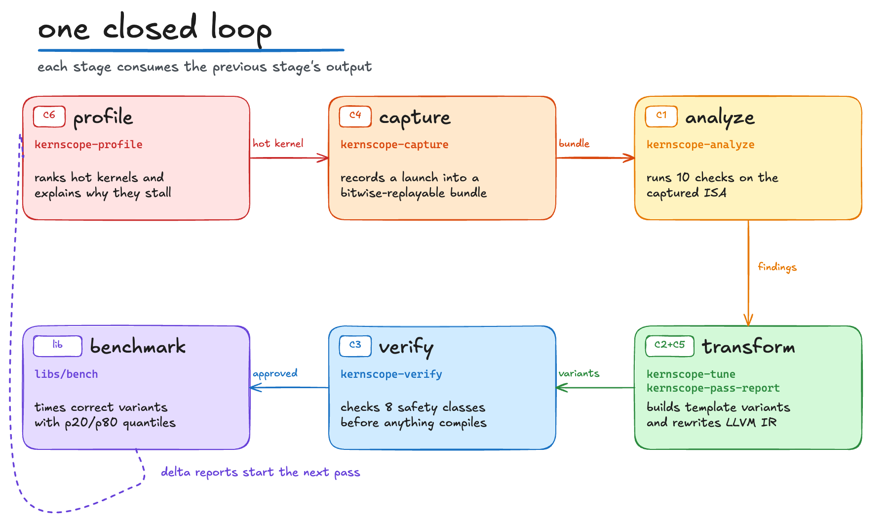
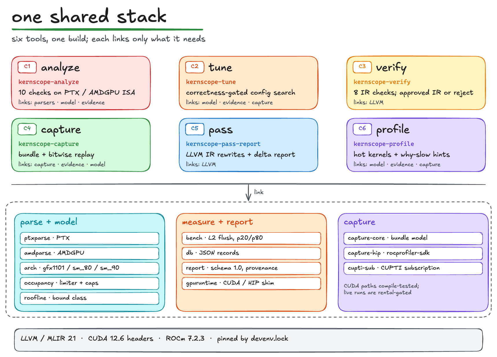
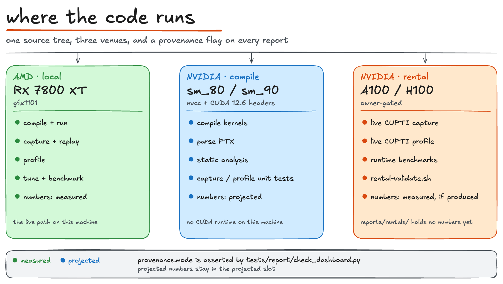

# kernscope

kernscope is a C++20 toolchain for GPU kernels. It profiles a running binary,
captures the hot launch, analyzes the captured ISA, generates or rewrites
variants, verifies them before they compile, and benchmarks the result. Six
tools live in one build and target NVIDIA CUDA and AMD HIP.

It is for GPU kernel engineers who need to explain why a kernel is slow, test a
rewrite, and hand over evidence someone else can reproduce. Each stage consumes
the previous stage's output, and every report records whether a number is
`measured` or `projected`.

## Quick start

The live path needs Linux x86_64, Nix with devenv, and an AMD GPU at
`/dev/kfd`. `devenv.lock` pins LLVM/MLIR 21, CUDA 12.6 headers, and ROCm 7.2.3.

```bash
devenv shell
bash scripts/ci.sh        # configure, build, and run the gate
bash scripts/demo.sh      # profile -> capture -> analyze -> tune -> verify
```

`demo.sh` writes one cross-tool report to `reports/demo/report.json`; the
consolidated run took 153 s against a 900 s budget. To regenerate the evidence
from a clean checkout, run `bash scripts/reproduce-all.sh` inside the same
shell; it chains the lock check, `ci.sh`, `demo.sh`, and the dashboard.

NVIDIA runtime validation never runs automatically:

```bash
bash scripts/rental-validate.sh --dry-run   # print the command sequence
```

## The loop



`scripts/demo.sh` runs five stages: profile, capture, analyze, capture-tune, and
verifier-gated tune with a pass delta. The tools are separate executables. The
analyzer runs on the captured kernel's disassembled ISA, the verifier gates
tuner variants before they compile, and the aggregated report links the
profiler hint to the analyzer findings.

| Tool | Command | What it does |
|---|---|---|
| C1 analyze | `kernscope-analyze` | Runs 10 checks on PTX or AMDGPU assembly: registers, occupancy, coalescing, bank conflicts, divergence, barriers, instruction mix, tensor cores, spills, and latency. |
| C2 tune | `kernscope-tune` | Searches matmul, bias_gelu, softmax, layernorm, reduction, and flash_attention for the fastest correct config, with a roofline and occupancy pre-screen and an arch-keyed JSON cache. |
| C3 verify | `kernscope-verify` | Compiles CUDA or HIP to LLVM IR, checks 8 error classes, and returns approved IR only when every verdict is `SAFE`. |
| C4 capture | `kernscope-capture` | Records a launch into a bundle that preserves virtual addresses and replays bitwise, and emits a standalone C++ reproducer. |
| C5 pass | `kernscope-pass-report` | Reports before/after analyzer deltas for the `kernscope-pass` LLVM 21 plugin: promotion, tiling, vectorization, padding, redundant-load elimination, and coalescing analysis. |
| C6 profile | `kernscope-profile` | Traces launches, times every kernel, ranks hot kernels, and emits occupancy and roofline hints. |

`libs/bench` provides the timing harness the tuner and capture tools call, and
`kernscope-dashboard` folds the committed reports into
`reports/dashboard.html`.

## The shared stack



Parsers, the hardware model, the benchmark harness, the report schema, and the
capture backends each have one implementation in `libs/`, shared by the tools
that need them. The verifier and the `kernscope-pass` plugin link LLVM directly.

## Where the code runs



Live numbers come from the local RX 7800 XT (gfx1101). `nvcc` compiles kernels
for sm_80 and sm_90 against CUDA 12.6 headers; the resulting PTX can be
analyzed locally, but no NVIDIA runtime runs on this machine. Live CUPTI
capture and profiling run only on a rented A100/H100 host through
`scripts/rental-validate.sh`, and no rental numbers are committed.

## Tests and evidence

Every CTest case carries one label: `no-gpu`, `gpu-amd`, or
`gpu-nvidia-rental`. `scripts/ci-baseline.txt` sets a floor of 550 cases, so a
test that silently disappears fails the gate. `ci.sh` builds with `-Werror`, runs
lit/FileCheck and the NumPy bfloat16 goldens, compiles generated kernels with
`nvcc` and `hipcc`, caps committed fixtures at 64 MB, and guards against
vendored NVIDIA headers.

Reports carry `schema_version` 1.0 and a per-section `provenance.mode`.
`tests/report/check_dashboard.py` asserts the provenance values. The dashboard
writes `reports/dashboard.html` and aggregates the per-tool evidence at run
time.

## Documentation

- [Technical report](docs/report/kernscope-technical-report.pdf): architecture, the six tools, schemas, capture and verification contracts, testing, the hardware strategy, and the measured evidence.
- [Report sources](docs/report/): LaTeX, TikZ figures, bibliography, and the vendored flora package.
- [Architecture diagrams](docs/diagrams/): editable Excalidraw sources and PNG exports.

The report is the archival account of the committed evidence. The scripts
regenerate the runtime reports under `reports/` on a gfx1101 machine; the
report records the values from the consolidated run.
