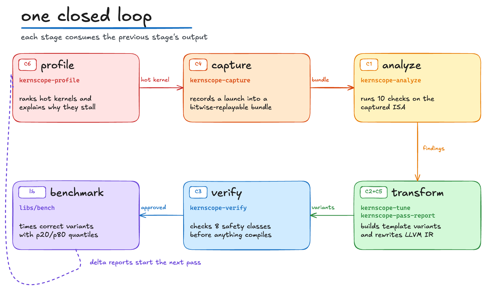
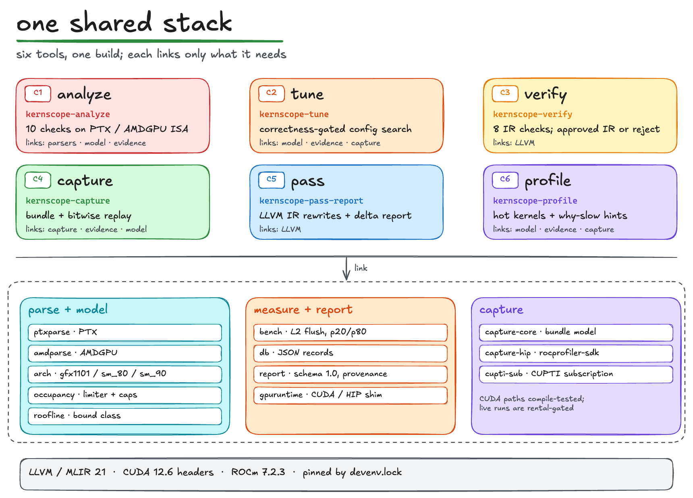
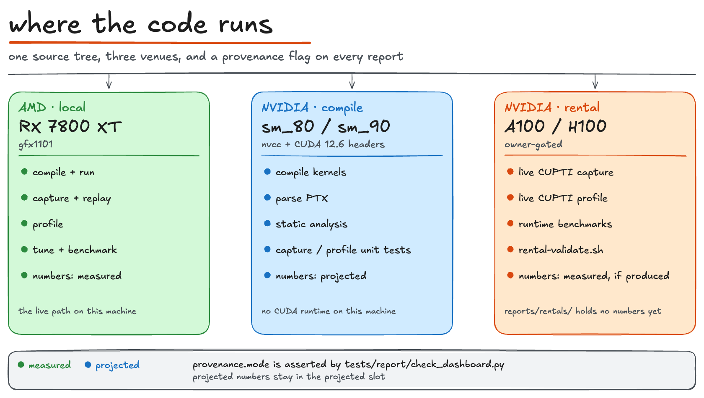

# kernscope architecture

The unified GPU-kernel tooling suite: how the six tools fit together, the
hardware strategy, and the CUDA-13 migration surface.

- [The loop](#the-loop)
- [Library stack](#library-stack)
- [Dual-path hardware strategy](#dual-path-hardware-strategy)
- [CUDA-13 migration surface (Metis H-2)](#cuda-13-migration-surface-metis-h-2)
- [Capture mechanism comparison](#capture-mechanism-comparison)
- [Verifier soundness scope](#verifier-soundness-scope)

## The loop

The six tools form one closed loop. A kernel enters as source or a running
binary and comes out with verified, tuned, profiled evidence:

Concretely, `scripts/demo.sh` runs the loop end-to-end in one command
(todo 55) and emits one aggregated cross-tool report
(`reports/demo/report.json`): the profiler's memory-bound hint carries
`analyzer_cross_refs` pointing at the analyzer finding ids produced from the
*captured* kernel's disassembled ISA — the tools validate each other, they do
not self-report.

## Library stack

Tools use the infrastructure they need from `libs/` and LLVM 21; nothing
depends downward on a tool.

The diagram groups the libraries by role. The exact link set:

| Tool | Libraries |
|---|---|
| `analyze` | `ptxparse`, `amdparse`, `arch`, `occupancy`, `report`, `db` |
| `tune` | `arch`, `occupancy`, `roofline`, `bench`, `db`, `gpuruntime`, `capture-core`, `report`; plus the matmul, elementwise, and flash-attention generators |
| `verify` | LLVM |
| `capture` | `capture-core`, `bench`, `gpuruntime`, `arch`, `db`; plus the `capture-hip` or `cupti-sub` backend |
| `pass` | LLVM |
| `profile` | `occupancy`, `roofline`, `report`, `db`; plus the CUPTI or rocprofiler-sdk tracer |
| `kernscope-bench` | `bench`, `db`, `gpuruntime`, `arch` |
| `kernscope-ptxdump` | `ptxparse`, `db` |

Cross-tool edges that make the loop closed (see
`scripts/demo.sh` stage comments):

- `profile → capture`: the profiler ranks hot kernels; capture records the
  hot one.
- `capture → analyze`: the analyzer runs on the *captured* kernel's
  disassembled ISA, not on a hand-picked example.
- `capture → tune`: `kernscope-tune --from-capture` searches launch
  configurations over the captured bundle (bitwise-validated candidates).
- `tune → verify`: `kernscope-tune --verify` gates template variants with the
  verifier before compiling them.
- `pass → analyze`: `kernscope-pass-report --report-pipeline` measures the
  pass before/after delta with the analyzer (vector width, vectorized loads,
  coalescing class).
- `profile ↔ analyze`: profiler diagnostics cross-reference analyzer finding
  ids (`analyzer_cross_refs` in the demo report).

## Dual-path hardware strategy

Every NVIDIA-runtime capability has two implementations with different
venues, so the suite is fully testable on this machine (AMD RX 7800 XT /
gfx1101) with zero rentals:

| Capability | CUDA (NVIDIA) | HIP (AMD, local) |
|---|---|---|
| Compile | `nvcc` sm_80/sm_90 **compile-only** (vendored headers from nix store; NO vendored NVIDIA headers committed) | `hipcc` gfx1101 compile + **live run** |
| Static analysis | PTX corpus (sm_80/sm_90/sm_100 examples) | AMDGPU ISA corpus (gfx1101) |
| Capture/replay | CUPTI callback/injection + LD_PRELOAD shim; mock-runtime record → reproducer **compile check only** | rocprofiler-sdk live: record → bitwise replay PASS |
| Profiling | CUPTI activity tracer: **compile + unit only** (synthetic Kernel9 buffers) | rocprofiler-sdk live: layernorm_fused traced, hot-kernel ranked |
| Tuning/benchmark | template + launch-config search compile-only; runtime benchmark **rental-gated** | full correctness-gated live benchmark on gfx1101 |
| LLVM passes | `llc nvptx64` PTX compile-only (sm_80) | `llc amdgcn` + live gfx1101 benchmark |

Rules that enforce honesty (asserted by `tests/report/check_dashboard.py` and
the ci.sh guards):

- **NVIDIA runtime is owner-gated**: `scripts/rental-validate.sh` is the ONLY
  path that runs NVIDIA code; it is never auto-triggered (`--dry-run` prints
  the sequence first). Reports carry `provenance.mode` = `measured` |
  `projected`; projected numbers are never presented as measured.
- **No vendored NVIDIA headers** are committed (ci.sh filename + content
  guards); the nix store resolves `#include <cuda_occupancy.h>`-style names
  at build time.
- **No rental claims in the README**: `reports/rentals/` holds no numbers yet;
  they appear only when the owner produces them.

## CUDA-13 migration surface (Metis H-2)

The suite pins CUDA 12.6 (`cudaPackages_12_6`, `CUPTI_API_VERSION 24`) but
documents the 13.x surface so a bump is a compile error at ONE place, never a
silent parse shift. The versioned adapter
(`tools/profile/include/kernscope/profile/record_adapter.h`, todo 49) is the
canonical note; summary:

- **CUPTI kernel records**: 12.x delivers `CUpti_ActivityKernel9`; 13.x
  delivers `CUpti_ActivityKernel10` (the 12.x struct moves to
  `cupti_activity_deprecated.h`). `Kernel10 == Kernel9 + uint8_t
  isDeviceLaunched` at the TAIL (+3 padding bytes). The parser is a template
  over the delivered struct (`ActivityKernelT` typedef, chosen by
  `CUPTI_API_VERSION`), so all read fields sit at identical offsets in both
  structs (pinned by `static_assert`s) and `isDeviceLaunched` is read via
  SFINAE member detection: a 12.x build compiles against Kernel9 (field
  absent → 0), a 13.x build against Kernel10. A header bump surfaces here as
  a compile error — the ONLY place that reads raw CUPTI activity records.
- **Removed in CUDA 13**: CUPTI Event API (`cupti_events.h`) and Metric API
  (`cupti_metrics.h`) — calls return
  `CUPTI_ERROR_LEGACY_PROFILER_NOT_SUPPORTED` (38); the PC-sampling
  ACTIVITY kind (replaced by `cupti_pcsampling.h`); nvprof and NVIDIA Visual
  Profiler entirely. This suite MUST NOT use Event/Metric APIs (enforced in
  `tools/profile/CMakeLists.txt`); all profiling data comes from the
  Activity API only.
- **Deprecated → replacement**: Profiling API (`cupti_profiler_target.h`)
  and PerfWorks Metric API (`nvperf_host.h`) → CUPTI Range Profiling API
  (`cupti_range_profiler.h`) + Profiler Host API (`cupti_profiler_host.h`).
- **Multi-subscriber V2 APIs** (`cuptiSubscribe_v2`,
  `cuptiActivityEnable_v2`, `cuptiActivityRegisterCallbacks_v2`) arrive with
  CUDA 13.3+; the 12.x single-subscriber path used here degrades to the
  fallback when a second subscriber is active (the libs/cupti-sub
  single-tool scope contract).
- **Record kind discipline**: only `CUPTI_ACTIVITY_KIND_CONCURRENT_KERNEL`
  (10) is enabled — the serializing `KERNEL` kind (3) changes collection
  behavior and is never used (kineto does the same).
- `CUPTI_API_VERSION`: 24 == CUDA 12.6; CUDA 13.0 reports 130001.

## Capture mechanism comparison

| Mechanism | Vendor | Status in kernscope | Notes |
|---|---|---|---|
| CUPTI callback/injection (`CUPTI_API_ENTER/EXIT`, `CUDA_INJECTION64_PATH`) | NVIDIA | primary (research overturned the LD_PRELOAD-first draft) | records memcpys + launches with VA-faithful arguments; Memory-kind records feed the libs/cupti-sub allocation map |
| LD_PRELOAD shim on the runtime API | NVIDIA | fallback | used when injection is unavailable; same record shape |
| rocprofiler-sdk intercept | AMD | live (gfx1101) | HIP_RUNTIME_API + kernel dispatch tracing, correlation_id join; bitwise replay validated |

Full details: `docs/capture.md`, `docs/capture-format.md`,
`docs/capture-mapping.md`, and the research brief
`docs/research/capture-replay-research-brief.md`.

## Verifier soundness scope

`kernscope-verify` is a static IR-level verifier, not a formal prover. Its
exact in-scope/out-of-scope contract (verdicts, in-scope analyses,
false-positive classes, false-negative classes, future upgrade path) is
documented in `docs/verify-soundness.md`; the check-class reference is
`docs/verify.md`. The tuning integration (`kernscope-tune --verify`) treats
verifier verdicts as a gate — an injected `MAY_OOB` variant is gated out
before compilation (see `reports/demo/stage-5-verify-tune.json`).
